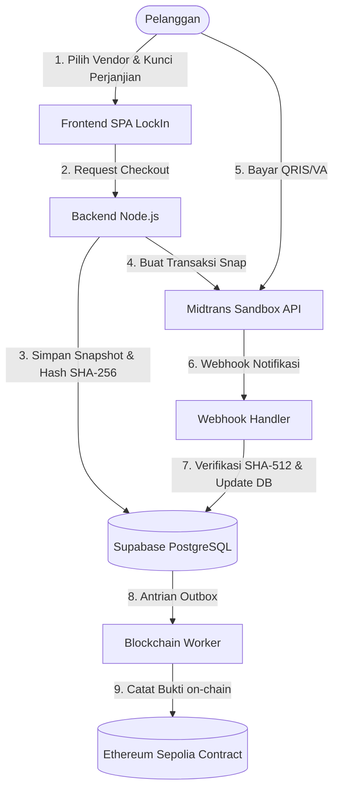

# 📊 Dokumen Business Case: LockIn Platform

> **Platform Booking Vendor Wisuda dengan Escrow Payment & Audit Trail Blockchain**  
> *Mata Kuliah: Teknologi Blockchain & Platform Keuangan Digital — Universitas Brawijaya*

---

## 1. Ringkasan Eksekutif (Executive Summary)

**LockIn** adalah platform marketplace khusus penyedia jasa wisuda (Fotografi/Content Creator, MUA, Hair/Hijab Stylist, Pendamping Wisuda/PA, dan Rental Acrylic Sign) yang menyelesaikan masalah ketidakpastian transaksi antara pelanggan (wisudawan) dan vendor independen (freelancer/UMKM).

Selama ini, transaksi jasa wisuda bernilai miliaran rupiah per musim wisuda dilakukan secara informal via media sosial (Instagram & WhatsApp) dengan metode transfer langsung (DP luring). Praktik ini memicu risiko tinggi:
- **Pelanggan:** Rawan kehilangan uang muka (DP), vendor terlambat/tidak hadir (*ghosting*), hasil tidak sesuai janji, dan kesulitan klaim *refund*.
- **Vendor:** Risiko pembatalan mendadak H-1, jadwal terblokir tanpa kepastian, dan penagihan pelunasan yang macet.

LockIn hadir dengan solusi terintegrasi:
1. **Digital Agreement Locking:** Snapshot kesepakatan detail dikunci dengan kriptografi SHA-256.
2. **Payment Escrow (Midtrans):** Pembayaran bertahap (DP 30% dan Pelunasan) ditahan secara aman di sistem rekening penampung.
3. **Immutable Blockchain Audit Trail (Ethereum Sepolia):** Status kontrak dan pembayaran dicatat *on-chain* sebagai bukti hukum digital yang tidak dapat dimanipulasi sepihak.
4. **Mekanisme Sengketa & Refund Berkeadilan:** Aturan pembatalan proporsional berbasis batas waktu (H-7, H-3, H-0) dengan panel mediasi admin.

---

## 2. Analisis Masalah (Problem Statement)

### 2.1 Masalah Sisi Pelanggan (Wisudawan & Keluarga)
1. **Risiko Penipuan & *Vendor Ghosting*:** Tidak adanya perlindungan dana saat mentransfer DP ke rekening pribadi vendor asing.
2. **Perjanjian Lisan yang Rapuh:** Syarat kerja (jumlah foto edit, jam tiba, toleransi keterlambatan) hanya dibahas via chat WA yang mudah terhapus atau dipelintir.
3. **Ketidakpastian *Refund*:** Ketika vendor berhalangan hadir atau hasil kerja buruk, pelanggan kesulitan menarik kembali uang yang sudah dibayarkan.

### 2.2 Masalah Sisi Vendor (Freelancer & Kreator)
1. **Pembatalan Sepihak Tanpa Kompensasi:** Pelanggan kerap membatalkan sewa slot di H-1 karena perubahan tanggal seremoni fakultas.
2. **Pelunasan Tertunda:** Vendor sering kesulitan menagih sisa 70% pembayaran setelah acara usai.
3. **Friksi Biaya Operasional Luar Kota:** Belum adanya standarisasi biaya transport dan konfirmasi persetujuan slot lintas wilayah.

### 2.3 Kekurangan Solusi Saat Ini
| Solusi Saat Ini | Kekurangan |
|---|---|
| **WhatsApp / DM IG Manual** | Tanpa jaminan dana, tanpa kontrak legal, risiko penipuan tinggi. |
| **Marketplace Umum (Shopee/Tokopedia)** | Tidak dirancang untuk alur jasa (tidak ada penjadwalan tanggal acara, DP bertahap, dan kalender ketersediaan). |
| **Platform Wedding (Bridestory)** | Terlalu mahal untuk vendor mahasiswa/wisuda berskala mikro, fokus pada pernikahan (tiket transaksi puluhan juta). |

---

## 3. Proposisi Nilai (Value Proposition)

```
                       +-----------------------------------+
                       |              LOCKIN               |
                       +-----------------+-----------------+
                                         |
         +-------------------------------+-------------------------------+
         |                                                               |
         v                                                               v
[ Nilai untuk Pelanggan ]                                     [ Nilai untuk Vendor ]
• Jaminan DP Aman (Escrow)                                    • Kepastian Jadwal & Booking Terkunci
• Kontrak Terbuka & Aturan Refund Transparan                  • Kepastian Pembayaran Pelunasan
• Bukti On-Chain Terverifikasi                                • Standarisasi Biaya Transport
• Mediasi Sengketa Cepat & Adil                               • Akses Pasar Mahasiswa Lebih Luas
```

- **Keamanan Finansial:** Uang pelanggan tidak langsung cair ke vendor sebelum acara berlangsung atau konfirmasi selesai.
- **Integritas Perjanjian Tanpa Keraguan:** Dokumen digital diikat dengan hash on-chain, menjamin isi kesepakatan tidak dapat diubah di tengah jalan oleh pihak mana pun.
- **Kemudahan Pembayaran:** Mendukung kanal modern Indonesia (QRIS, Virtual Account BCA/Mandiri/BRI/BNI, serta E-Wallet).

---

## 4. Analisis Pasar (Market Analysis)

### 4.1 Target Pelanggan (Buyer Persona)
- **Primary:** Mahasiswa tingkat akhir (S1/D3/D4/S2) usia 20–25 tahun di kota-kota pendidikan tinggi. Karakteristik: digital-native, mengutamakan estetika dokumentasi, sensitif terhadap penipuan online.
- **Secondary:** Orang tua / wali wisudawan yang membiayai kebutuhan wisuda.

### 4.2 Target Vendor (Seller Persona)
- Fotografer & Graduation Content Creator (GCC) freelance (mahasiswa atau fresh graduate).
- Makeup Artist (MUA) & Stylist Hijab/Hairdo lokal.
- Pengrajin penyewaan Acrylic Welcome/Standing Sign.
- Pendamping Wisuda (PA Wisuda) freelance.

### 4.3 Estimasi Ukuran Pasar (TAM, SAM, SOM)
Contoh studi kasus di **Kota Malang** (Fokus Validasi Awal):
- **TAM (Total Addressable Market - Indonesia):**
  - ~1,8 juta lulusan perguruan tinggi per tahun di Indonesia.
  - Rata-rata pengeluaran jasa wisuda: Rp1.000.000 / wisudawan.
  - Nilai potensi pasar nasional: **Rp1,8 Triliun / tahun**.
- **SAM (Serviceable Available Market - Kota Pendidikan Utama Jawa Timur):**
  - Malang & Surabaya: ~120.000 lulusan PTN/PTS per tahun (UB, UM, UIN, Unair, ITS, dll.).
  - Nilai pasar: **Rp120 Miliar / tahun**.
- **SOM (Serviceable Obtainable Market - Tahap 1 Malang):**
  - Target 5% penetrasi wisudawan Kota Malang pada tahun pertama (~3.000 booking).
  - Estimasi GMV (Gross Merchandise Value): **Rp1,5 Miliar**.

---

## 5. Model Bisnis & Monetisasi (Business Model)

LockIn menerapkan model bisnis **Transaction Fee Marketplace**:

```
+--------------------------------------------------------------------------+
|                            Sumber Pendapatan                             |
+-------------------+------------------------------------------------------+
| 1. Platform Fee   | Biaya layanan 3% dari total nilai jasa (dibebankan  |
|    (Take Rate)    | kepada pelanggan saat checkout DP).                  |
|                   | Contoh: Transaksi Rp500.000 -> Fee = Rp15.000        |
+-------------------+------------------------------------------------------+
| 2. Vendor Premium | Fitur promosi berbayar (Featured Listing) agar        |
|    (Listing Fee)  | vendor muncul di bagian teratas katalog pencarian.   |
+-------------------+------------------------------------------------------+
| 3. Transport &    | Tambahan komisi mikro untuk penanganan sengketa      |
|    Dispute Fee    | kompleks yang membutuhkan investigasi manual tim.     |
+-------------------+------------------------------------------------------+
```

### Proyeksi Keuangan Sederhana (Tahun Pertama - 3.000 Transaksi)
- Rata-rata Nilai Transaksi: **Rp450.000**
- Total GMV: **Rp1.350.000.000**
- Pendapatan Platform Fee (3%): **Rp40.500.000**
- Pendapatan Listing Premium Vendor (50 vendor x Rp100.000/bln x 4 bln musim wisuda): **Rp20.000.000**
- **Estimasi Pendapatan Kotor Tahun 1:** **~Rp60.500.000**

---

## 6. Kelayakan Teknis & Integrasi (Technical Feasibility)

LockIn telah mengimplementasikan arsitektur *production-grade* yang memadukan Web2 (kecepatan & kemudahan pengguna) dengan Web3 (integritas audit permanen):



### Keunggulan Teknis:
1. **User Experience Mulus (No Web3 Friction):** Pelanggan dan vendor tidak diwajibkan memiliki wallet MetaMask atau membeli kripto untuk bertransaksi. Seluruh pembayaran menggunakan Rupiah melalui Midtrans.
2. **Outbox Pattern:** Pemrosesan blockchain dilakukan secara asinkron di latar belakang setiap 15 detik, sehingga kegagalan jaringan atau lonjakan gas fee tidak pernah menggagalkan pembayaran pengguna.
3. **Smart Contract Tunggal (`LockInEscrow.sol`):** Menyimpan hash dokumen perjanjian, bukti DP, bukti pelunasan, dan perubahan status dalam satu kontrak efisien.

---

## 7. Analisis Risiko & Mitigasi (Risk Management)

| Risiko | Tingkat | Dampak | Strategi Mitigasi |
|---|---|---|---|
| **Regulasi Finansial (Izin Penampungan Dana)** | Tinggi | Operasional | Menggunakan payment gateway berlisensi resmi Bank Indonesia (Midtrans) sebagai mitra pemroses transaksi dan *escrow aggregator*. |
| **Biaya Gas Fee Blockchain** | Sedang | Finansial | Hanya menyimpan representasi `bytes32` (hash SHA-256) bukan seluruh dokumen; masa depan dapat dimigrasikan ke L2 berbiaya rendah (Base/Arbitrum/Polygon). |
| **Sengketa Kualitas Subjektif (Hasil Foto/Riasan)** | Sedang | Reputasi | Perjanjian digital mewajibkan spesifikasi terukur (misal: "minimal 30 foto edit, batas revisi 1x, waktu penyerahan maks 7 hari"). |
| **Musim Wisuda Bersifat Siklikal** | Sedang | Arus Kas | Melakukan ekspansi vertikal ke acara formal lain di luar wisuda (yudisium, seminar proposal, foto kelulusan SMA/SMP, pre-wedding). |

---

## 8. Rencana Implementasi & Roadmap

```
+--------------------------------------------------------------------------+
|                               ROADMAP                                    |
+-------------------+------------------------------------------------------+
| Fase 1 (Selesai)  | • Proof of Concept (PoC) Payment Midtrans & Sepolia  |
|                   | • Struktur folder modular & database Supabase        |
|                   | • Smart Contract tunggal LockInEscrow.sol            |
|                   | • 11 Unit test keamanan & script audit on-chain      |
+-------------------+------------------------------------------------------+
| Fase 2 (Q1 - Q2)  | • Autentikasi Google OAuth & Profile Management      |
|                   | • Peluncuran Beta Katalog Vendor Malang              |
|                   | • Verifikasi portofolio & identitas vendor (KYV)     |
+-------------------+------------------------------------------------------+
| Fase 3 (Q3 - Q4)  | • Migrasi smart contract ke Layer-2 (Base Mainnet)   |
|                   | • Fitur otomatisasi split payment ke rekening vendor |
|                   | • Ekspansi ke Surabaya, Yogyakarta, dan Bandung      |
+-------------------+------------------------------------------------------+
```

---

## 9. Kesimpulan

**LockIn** bukan sekadar direktori vendor konvensional, melainkan solusi infrastruktur kepercayaan (*trust infrastructure*) untuk ekonomi kreatif wisuda. Dengan mengombinasikan kemudahan pembayaran gateway domestik dan kepastian hukum matematis melalui blockchain, LockIn memberikan rasa aman 100% bagi pelanggan wisudawan sekaligus menjamin kepastian pendapatan bagi pelaku usaha kreatif lokal.
